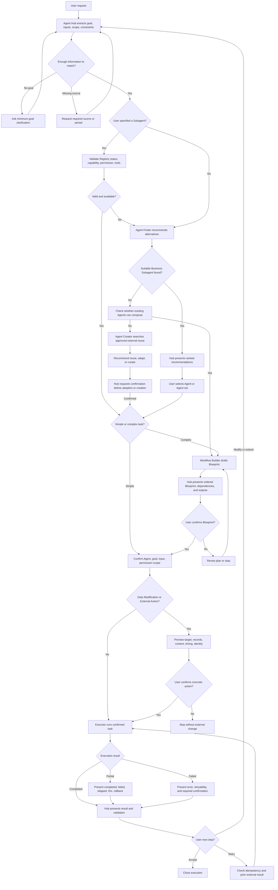
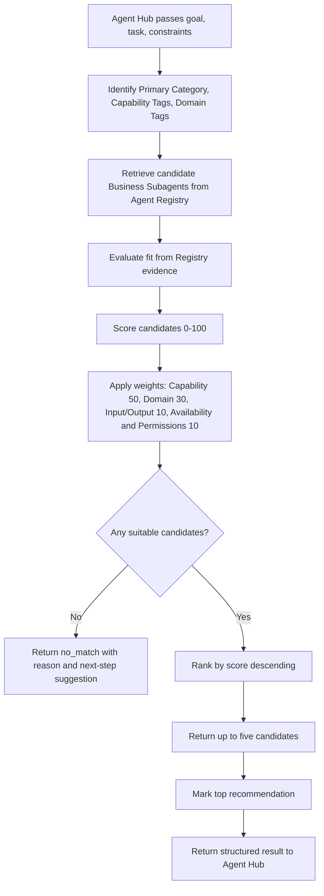

# Agent Hub

Agent Hub is an enterprise-grade intelligent agent discovery, recommendation, orchestration, and execution platform.

The platform solves a growing enterprise problem: as internal and marketplace agents increase, users struggle to discover the right agent, compare overlapping capabilities, avoid duplicated builds, and improve the utilization of existing agents.

## Product Vision

Users should not need to know agent names, technical implementations, or invocation methods. They should be able to describe a business need in natural language, and Agent Hub should guide the full path:

```text
Understanding
  -> Discovery
  -> Matching
  -> Recommendation
  -> Confirmation
  -> Workflow Building, when needed
  -> Execution
  -> Results
```

The long-term goal is to become a unified navigation, management, and scheduling center for enterprise agents, improving agent discoverability, utilization, reuse, collaboration efficiency, and return on investment.

## Core Architecture

The system uses one main agent, four functional agents, and multiple business subagents.

The current library contains 172 Business Subagents after the first capability deduplication pass. See [Agent Registry](Agent-Registry.md) for current counts.

```text
User
  -> Agent Hub
      -> Agent Finder
      -> Workflow Builder
      -> Agent Executor
      -> Agent Creator
      -> Agent Registry
      -> business-subagents/
```

### Agent Hub

Agent Hub is the core of the system and the only agent that directly interacts with users and presents final results.

Responsibilities:

- Understand user requests and business intent.
- Identify task type and complexity.
- Decide which functional agent or agents should be called.
- Manage user confirmation before execution.
- Consolidate structured outputs from other agents.
- Explain recommendations, plans, execution status, and final results to the user.

Agent Hub handles users who want to:

- Learn what agents currently exist.
- Search for a type of agent.
- Find the best agent for a specific task.
- Execute a simple task.
- Complete a complex task requiring multiple agents.
- Create a new agent when no suitable existing agent is available.

### Agent Finder

Chinese name: 智能体发现助手

Agent Finder discovers and recommends suitable agents from the enterprise-certified and recommended Subagent resource library.

Use Agent Finder when:

- The user wants to know what agents exist.
- The user searches for agents by category, keyword, goal, or business scenario.
- The user wants the best agent for a task.
- The user wants to execute a task but has not specified the target agent.

Expected behavior:

- Retrieve and match Business Subagents based on Agent Registry, not only keyword hits.
- Identify likely Primary Category, Capability Tags, and Domain Tags from the user's goal, task content, and constraints.
- Follow the Retrieve Candidates -> Evaluate Fit -> Rank Candidates -> Return Recommendations process.
- Evaluate capability match, domain relevance, input/output compatibility, availability, and permissions.
- Return up to five suitable candidate agents when matches exist.
- Include 0-100 matching score, match level, matched keywords, core capabilities, use cases, strengths, limitations, and recommendation rationale.
- Clearly identify the most recommended agent.
- Make scoring explainable. Do not invent scores without evaluation basis.
- Do not mark unavailable agents or agents missing required permissions as directly executable.
- Do not recommend clearly mismatched agents just to fill five candidates.
- If the user only wants an overview, summarize available agent categories, counts, main capabilities, and representative agents based on Registry.
- If no suitable agent exists, clearly state that there is no appropriate match instead of forcing a weak recommendation.
- Return structured results to Agent Hub. Agent Finder does not execute tasks or communicate final results directly to users.

### Workflow Builder

Chinese name: 工作流编排助手

Workflow Builder designs multi-agent workflows for complex tasks.

Use Workflow Builder when:

- A task requires multiple agents to collaborate.
- A task needs decomposition into ordered steps.
- The user has selected or confirmed candidate agents, and a workflow plan is needed before execution.

Expected behavior:

- Break complex goals into executable steps.
- Identify the agent required for each step.
- Define execution order, dependencies, inputs, outputs, and expected results.
- Generate a complete Workflow Blueprint.
- Return the Workflow Blueprint to Agent Hub for user-facing explanation and confirmation.

Example workflow:

```text
Collect data
  -> Analyze data
  -> Generate report
  -> Send email
```

### Agent Executor

Chinese name: 任务执行与调度助手

Agent Executor is responsible only for authorized execution and runtime scheduling.

Use Agent Executor when:

- The user has confirmed a single-agent task.
- The user has confirmed a Workflow Blueprint.
- Agent Hub has already selected the execution path and authorized the scope.

Responsibilities:

- Assign tasks to selected Subagents.
- Pass required inputs, context, and intermediate results.
- Control execution order.
- Track task status.
- Handle execution exceptions.
- Aggregate final results and return them to Agent Hub.

Boundaries:

- Agent Executor does not perform initial requirement recognition.
- Agent Executor does not recommend agents.
- Agent Executor does not design workflows.
- Agent Executor may make necessary scheduling adjustments within the authorized scope.
- If execution requires adding a new agent, changing the task goal, expanding permissions, or performing unauthorized operations, Executor must return to Agent Hub for user confirmation.

### Agent Creator

Chinese name: 智能体创建助手

Agent Creator helps analyze capability gaps, search for reusable internal or external solutions, and draft new agent definitions only when reuse or adaptation is insufficient.

Use Agent Creator when:

- Agent Finder cannot find a suitable existing agent.
- The platform needs to determine whether existing agents can be combined to meet the need.
- Existing internal Agents are insufficient and external reusable Agent patterns, templates, repositories, or marketplace examples should be considered.
- A genuinely new agent may be required.

Expected behavior:

- Analyze the capability gap.
- Decide whether the need can be met by composing existing agents.
- Search the web, GitHub, marketplaces, or other approved external sources for reusable Agent patterns, templates, repositories, or design references when useful.
- Evaluate whether the best path is to reuse an existing solution, adapt an existing solution, or create a new Agent.
- If a new Agent is needed, draft its capability definition, responsibilities, input and output requirements, tool requirements, Markdown instructions, and configuration plan.
- Return the proposed definition to Agent Hub for user confirmation before creation.

### Subagents

Subagents are business agents stored in the `business-subagents/` folder. They form the platform's callable business-agent resource library.

Each Subagent should gradually include:

- Primary Category
- Capability Tags
- Domain Tags
- Capability description
- Usage scenarios
- Invocation conditions
- Input and output expectations
- Execution method
- Limitations

### Agent Registry

Agent Registry is an independent Markdown index file that records existing agents in one place.

It is the single source of truth for agent classification, counts, and candidate recommendation. The system should not maintain duplicate registry data elsewhere.

It should include each agent's basic information, primary category, capability tags, domain tags, keyword metadata, and status so Agent Finder can search, compare, and match agents efficiently.

Agent Registry must distinguish:

- Functional Agents: Agent Finder, Workflow Builder, Agent Executor, and Agent Creator.
- Business Subagents: callable business agents stored in `business-subagents/`.

Agent Hub is the standalone main Agent and is maintained outside the Functional Agent group. Functional Agents are platform components and should not participate in ordinary business-agent recommendation or ranking. Business Subagents are the main retrieval and recommendation target for Agent Finder.

Business Subagents use a three-layer classification model:

- Primary Category: exactly one required primary category.
- Capability Tags: multiple allowed functional capability tags.
- Domain Tags: multiple allowed business-domain tags.

Primary Category must use one of these eight values:

- Knowledge and Research
- Document and Content
- Data and Analytics
- Business Operations
- Communication and Collaboration
- Development and Technology
- Compliance and Quality
- Specialized Business

Capability Tags examples:

- Search
- Retrieve
- Extract
- Compare
- Analyze
- Validate
- Summarize
- Generate
- Automate

Domain Tags examples:

- Clinical Research
- Regulatory
- Finance
- HR
- Supply Chain

Recommended registry fields:

- Name
- Chinese Name, for business Subagents only
- Type
- Primary Category
- Capability Tags
- Domain Tags
- Description
- Keywords
- Capabilities
- Use When
- Limitations
- Permission Level
- Status
- Last Updated

Permission Level must use one of these fixed values:

- Read-only: the Agent can inspect, retrieve, summarize, or analyze information without changing external state.
- Draft-only: the Agent can generate drafts, plans, recommendations, or content but cannot send, publish, modify, or submit anything.
- External Action: the Agent can perform outward-facing actions such as sending messages, creating tickets, or triggering external workflows after confirmation.
- Data Modification: the Agent can create, update, delete, submit, or otherwise modify records, files, systems, or business data after confirmation.

Status must use one of these fixed values:

- Active
- Draft
- Deprecated
- Unavailable

Status rules:

- Active: the Markdown definition is complete and available for discovery; this does not mean it is deployed, connected, or runtime-validated. Execution requires verified runtime availability, required inputs/tools, permissions, and user confirmation.
- Draft: can be browsed or discussed but should not be recommended for execution.
- Deprecated: should not be recommended unless the user explicitly asks about it.
- Unavailable: cannot be executed and should not be recommended for execution.

Last Updated must use `YYYY-MM-DD` format.

Agent Finder should avoid recommending Draft, Deprecated, or Unavailable agents for execution unless the user explicitly asks about them.

Future registry fields may include input/output types, permission requirements, and certification status. Current implementation remains Markdown-only and should not introduce JSON configuration files or a database.

## Interaction Rules

Only Agent Hub directly communicates with users in natural language.

All other functional agents and business Subagents return structured data to their upstream caller. They do not directly present content to users.

Recommended structured outputs include:

- Matching results
- Agent scores
- Workflow Blueprint
- Execution plan
- Execution status
- Exception information
- Task results

Agent Hub is responsible for consolidating, explaining, and presenting these outputs.

## User-Facing Output Style

Agent Hub should present user-facing results in concise Markdown that supports quick decisions. Users should see summaries, compact tables when comparison is useful, and clear confirmation questions. Users should not see internal JSON-like objects unless explicitly requested.

Use tables for Agent recommendations, Workflow Blueprints, or other comparison-heavy outputs. Use short paragraphs for explanatory outcomes such as no-match results, invalid Subagent explanations, or next-step suggestions. Do not turn every reason and suggestion into long bullet lists.

Agent recommendation tables should use these fields:

- Recommendation
- Agent
- Match Level
- Score
- Best For
- Why
- Limitations

Workflow Blueprint tables should use these fields:

- Step
- Agent
- Action
- Input
- Output
- Needs Confirmation

For no-match or unsuitable-Agent cases, prefer two short paragraphs:

```markdown
I could not find a suitable Agent for this request. The closest existing Agents are missing the required capability, do not support the provided input, or are not currently available for this business scenario.

The best next step is to ask Agent Creator to search and evaluate reusable solutions, combine existing Agents through Workflow Builder if partial capabilities exist, or narrow the task scope and run matching again.
```

## Human-in-the-Loop Principle

The system must clearly separate recommendation, planning, and execution.

Core rules:

- Unless the user has already specified a target agent, every task must first go through Agent Finder for matching and recommendation.
- If the user has specified a Subagent, Agent Hub must first verify that the Subagent exists, is available, and has the capability required for the current task.
- A verified user-specified Subagent can skip Agent Finder recommendation, but it cannot skip user confirmation.
- For any executable task, Agent Hub must present candidate agents or an execution plan before execution.
- Single-agent execution requires user confirmation.
- Multi-agent workflow execution requires user confirmation of the Workflow Blueprint.
- User selection of an Agent only means the execution object has been chosen. It does not authorize actual execution.
- User confirmation must cover the Agent, task goal, required input, and permission scope before execution starts.
- Finding a suitable agent does not automatically authorize execution.
- Generating a Workflow Blueprint does not automatically authorize execution.
- Any expansion of agent scope, task goal, execution permissions, or unauthorized operation requires renewed user confirmation through Agent Hub.

## Subagent Selection Rules

Before entering Agent Execution or Workflow Building, Agent Hub must determine whether the user has explicitly specified a Subagent.

If the user has specified a Subagent:

- Agent Hub checks whether the Subagent exists in the Subagent resource library.
- Agent Hub checks whether the Subagent is currently available.
- Agent Hub checks whether the Subagent has the capabilities required for the current task.
- If validation passes, Agent Hub does not need to call Agent Finder for recommendation or matching.
- If the Subagent does not exist, is unavailable, or lacks required capability, Agent Hub explains the reason and calls Agent Finder to recommend alternatives.
- If Agent Finder cannot find a suitable alternative, Agent Hub calls Agent Creator to analyze the capability gap.
- Agent Hub must still ask the user to confirm before any execution starts.
- For a single-agent task, Agent Hub calls Agent Executor after user confirmation.
- For a multi-agent task, Agent Hub calls Workflow Builder first, presents the Workflow Blueprint, asks for user confirmation, and then calls Agent Executor.

If the user has not specified a Subagent:

- Agent Hub must call Agent Finder before execution or workflow design.
- Agent Finder recommends suitable candidate agents based on the task requirements.
- Agent Hub presents matching scores, recommendation rationale, and capability differences.
- The user selects and confirms the preferred agent or agent set.
- Only after confirmation can the system proceed to Workflow Building or Agent Execution.

The system must always keep Agent selection, Workflow design, and Task execution as separate stages.

## Clarification Rules

Before calling Agent Finder, Workflow Builder, or Agent Executor, Agent Hub must check whether the user provided enough information.

If the request is missing the task goal or required input, Agent Hub should ask the minimum number of clarification questions needed to proceed. Agent Hub should not ask broad discovery questions when the missing information is narrow and specific.

## Task Complexity Rules

Agent Hub classifies task complexity before execution or workflow design.

A task is simple when it has:

- One clear capability requirement.
- A single input and output.
- No intermediate dependency.

A task is complex when it involves:

- Multiple stages.
- Multiple data sources.
- Multiple collaborating roles or agents.
- Approval steps.
- Multiple outputs.

Simple tasks can proceed to single-agent confirmation and Agent Executor. Complex tasks should proceed to Workflow Builder after required agents are selected or matched.

## Agent Finder Retrieval and Scoring

Agent Finder must use Agent Registry as the basis for browsing, counting, retrieval, matching, scoring, and recommendation.

When Agent Hub receives an Agent query or task execution request, Agent Hub extracts the user goal, task content, and necessary constraints, then passes that information to Agent Finder.

Agent Finder then follows this process:

1. Retrieve Candidates: identify relevant Primary Category, Capability Tags, and Domain Tags, then retrieve matching Business Subagents from Agent Registry.
2. Evaluate Fit: evaluate each candidate using Registry-recorded capabilities, constraints, input/output expectations, availability, and permissions.
3. Rank Candidates: calculate a 0-100 score and sort candidates from highest to lowest.
4. Return Recommendations: return up to five suitable candidates and identify the top recommendation.

Scoring weights:

- Capability Match: 50%.
- Domain Relevance: 30%.
- Input/Output Compatibility: 10%.
- Availability and Permissions: 10%.

Scores must be based on actual Registry records and include clear scoring rationale. Agent Finder must not invent scores without evidence. Keyword matches can support scoring but must not be the only basis for recommendation.

Unavailable agents or agents missing required permissions must not be marked as directly executable.

For each recommended candidate, Agent Finder should return:

- Matching score from 0 to 100.
- Match level.
- Matched keywords.
- Core capabilities.
- Applicable scenarios.
- Strengths.
- Limitations.
- Recommendation rationale.

Match level mapping:

- 90-100: Very Strong Match.
- 70-89: Strong Match.
- 50-69: Partial Match.
- Below 50: Weak Match. Do not recommend unless the user explicitly asks to see low-confidence options.

Agent Finder should include enough rationale for Agent Hub to explain why each candidate was included and why the top candidate is recommended.

For browsing or directory requests, Agent Finder should summarize Registry contents by category, including category counts, main capabilities, and representative agents.

If no suitable Business Subagent exists, Agent Finder must return a no-match result. Agent Hub can then suggest Agent Creator for sourcing and evaluating reuse, adaptation, or creation, or Workflow Builder for combining existing Agents when appropriate.

Agent Finder only performs matching and recommendation. It does not execute tasks, request execution confirmation, or present final user-facing results directly.

No-match routing:

- If existing Agents have partial capabilities that can be sequenced together, suggest Workflow Builder.
- If the core required capability is missing, suggest Agent Creator to search external sources and evaluate reuse, adaptation, or creation.
- If the goal, input, or scope is unclear, Agent Hub should ask clarification questions and then call Agent Finder again.

## Execution Result Review

After Agent Executor returns a result, Agent Hub presents the result and asks whether the user accepts it, wants modifications, wants a retry, or wants to extend the task.

If the user does not explicitly choose a next step, the system must not automatically retry, modify, extend, or continue execution.

If execution fails, Agent Executor must return:

- Error reason.
- Completed steps.
- Failed step.
- Retry suggestion.
- Whether user confirmation is needed before retrying.

## Flowcharts

### End-to-End Agent Hub Flow



### Agent Finder Retrieval and Scoring Flow



## Task Routing Logic

### Agent Overview Request

```text
User asks what agents exist
  -> Agent Hub
  -> Agent Finder summarizes categories, counts, capabilities, and examples
  -> Agent Hub presents the overview
```

### Agent Search or Recommendation

```text
User describes a goal, keyword, or business scenario
  -> Agent Hub
  -> Agent Finder retrieves and scores candidate agents
  -> Agent Hub presents about five candidates and the top recommendation
  -> User selects or confirms an agent
```

### Simple Task Execution

```text
User asks to execute a task
  -> Agent Hub checks whether a target agent was specified
  -> If specified, Agent Hub verifies existence, availability, and capability
  -> If not specified, Agent Finder recommends candidates
  -> Agent Hub presents the selected or recommended agent for confirmation
  -> Agent Executor runs the selected Subagent
  -> Agent Executor returns structured result
  -> Agent Hub presents final result
```

### Complex Workflow Execution

```text
User asks for a complex multi-step task
  -> Agent Hub identifies task complexity
  -> Agent Hub checks whether required Subagents were specified
  -> If specified, Agent Hub verifies existence, availability, and capability
  -> If not specified, Agent Finder matches required agents
  -> Workflow Builder creates a Workflow Blueprint
  -> Agent Hub presents the blueprint for confirmation
  -> Agent Executor executes the confirmed workflow
  -> Agent Executor returns structured status and results
  -> Agent Hub presents final result
```

For workflows containing Data Modification or External Action steps, the Blueprint confirmation is followed by a concrete action preview confirmation. A partial result does not automatically retry; the user must choose a next step, and Executor must check idempotency before retrying.

### New Agent Creation

```text
Agent Finder finds no suitable agent
  -> Agent Hub informs the user
  -> Agent Creator analyzes the capability gap
  -> Agent Creator searches internal and external reusable solutions when useful
  -> Agent Creator recommends reuse, adaptation, or new Agent creation
  -> Agent Hub asks the user to confirm the selected path and any Registry update
```

## Markdown Agent Definition Standard

The current project should only contain Markdown files. It should not include Python files, JSON configuration files, or other implementation code at this stage.

The initial implementation uses Markdown files to define agent roles, usage scenarios, and execution instructions. This keeps the design portable and prepares the system for future migration to Microsoft Copilot Studio.

All Agent Markdown files must use the same concise three-part structure:

- Name
- Description
- Instruction

Name requirements:

- Agent Hub and the four functional agents only need English names.
- Business Subagents in `business-subagents/` should include both `英文名称：` and `中文名称：` below the main heading.

Description requirements:

- Keep it short and explicit.
- Use as few words as possible to describe the agent's core function and when to use it.
- Do not include long background explanations.

Instruction requirements:

- Treat Instruction as the core instruction block, similar to a Skill.
- Define responsibilities, boundaries, trigger conditions, workflow, input and output requirements, calling rules, and necessary restrictions.
- Write executable instructions that help the Agent perform work, not just understand its role.
- Require functional agents and Subagents to return structured outputs as JSON-like objects inside Markdown code blocks when they report results upstream.
- Business Subagents must explicitly state that they do not communicate directly with users and return structured results to Agent Hub or the upstream functional Agent only.

Length and style requirements:

- Each Markdown file must stay under 8000 characters, including Name, Description, and Instruction.
- Reduce unnecessary blank lines, repeated explanations, redundant headings, and non-actionable text.
- Prefer clear, direct, executable instructions.
- Avoid repeating the same global rules across Agent Hub and the four functional Agent files.
- Keep each file focused on its own responsibilities and collaboration boundaries.

Recommended template for Agent Hub and functional agents:

```markdown
# English Name

## Description

Describe the agent's core role and when it should be used.

## Instruction

Define responsibilities, boundaries, trigger conditions, workflow, input/output requirements, calling rules, and restrictions.
```

Recommended template for business Subagents:

```markdown
# English Name

英文名称：

中文名称：

## Description

Describe the Subagent's core capability and when to use it.

## Instruction

Define responsibilities, trigger conditions, input/output requirements, execution rules, and limitations.
```

## Planned Repository Structure

```text
Agent-Hub/
  README.md
  Agent-Hub.md
  Agent-Registry.md
  functional-agents/
    Agent-Finder.md
    Workflow-Builder.md
    Agent-Executor.md
    Agent-Creator.md
  business-subagents/
    README.md
```

## Decision Log

| Date | Decision | Rationale | Status |
| --- | --- | --- | --- |
| 2026-10-14 | Use Agent Hub as the only user-facing agent. | Keeps user experience consistent and centralizes confirmation, explanation, and final output. | Accepted |
| 2026-10-14 | Use four functional agents: Agent Finder, Workflow Builder, Agent Executor, and Agent Creator. | Separates discovery, planning, execution, and creation responsibilities. | Accepted |
| 2026-10-14 | Store initial agent definitions as Markdown files. | Supports lightweight iteration and future migration to Microsoft Copilot Studio. | Accepted |
| 2026-10-14 | Require Human-in-the-Loop confirmation before execution. | Prevents unauthorized execution and keeps recommendation, planning, and execution distinct. | Accepted |
| 2026-10-14 | Keep the project Markdown-only at this stage. | Minimizes implementation overhead and keeps the agent definitions portable. | Accepted |
| 2026-10-14 | Store business Subagents in `business-subagents/` and maintain an independent Agent Registry. | Separates callable business agents from core orchestration agents and gives Agent Finder a central index. | Accepted |
| 2026-10-14 | Limit every Agent Markdown file to Name, Description, and Instruction under 8000 characters. | Reduces token usage and improves maintainability for Copilot Studio migration. | Accepted |
| 2026-10-14 | Keep the functional agent folder named `functional-agents/`. | Preserves the current structure and clearly separates functional agents from business Subagents. | Accepted |
| 2026-10-14 | Use Markdown code blocks containing JSON-like objects for upstream structured outputs. | Keeps files Markdown-only while preserving machine-readable response structure. | Accepted |
| 2026-10-14 | Add `Permission Level` and fixed `Status` values to Agent Registry. | Helps Agent Finder avoid unavailable or deprecated agents and supports scoped execution confirmation. | Accepted |
| 2026-10-14 | Require fallback from invalid user-specified Subagent to Agent Finder, then Agent Creator if needed. | Prevents failed direct execution while still respecting the user's preferred agent choice. | Accepted |
| 2026-10-14 | Require Agent Hub to confirm Agent, task goal, input, and permission scope before execution. | Makes Agent selection separate from execution authorization. | Accepted |
| 2026-10-14 | Define simple versus complex task routing criteria. | Gives Agent Hub a consistent rule for choosing Agent Executor or Workflow Builder. | Accepted |
| 2026-10-14 | Require post-execution user review and structured failure details. | Supports acceptance, modification, retry, and task extension after execution. | Accepted |
| 2026-10-14 | Use Primary Category, Capability Tags, and Domain Tags for Business Subagent classification. | Improves discovery, matching accuracy, and extensibility beyond department or technical-function categories. | Accepted |
| 2026-10-14 | Define eight fixed Primary Categories for Business Subagents. | Creates a stable top-level browsing and reporting structure for Agent Finder. | Accepted |
| 2026-10-14 | Make Agent Registry the single source of truth for classification, counts, and recommendations. | Avoids duplicated metadata and inconsistent search results. | Accepted |
| 2026-10-14 | Split Agent Registry into Functional Agents and Business Subagents. | Keeps platform orchestration components separate from user-facing business capability recommendations. | Accepted |
| 2026-10-14 | Require Agent Finder to evaluate fit beyond keyword matches. | Ensures recommendations consider capability fit, domain fit, input/output compatibility, and availability. | Accepted |
| 2026-10-14 | Use a four-step Agent Finder process: Retrieve Candidates, Evaluate Fit, Rank Candidates, Return Recommendations. | Makes discovery and recommendation behavior consistent and auditable. | Accepted |
| 2026-10-14 | Score Agent Finder recommendations using weighted criteria: Capability Match 50%, Domain Relevance 30%, Input/Output Compatibility 10%, Availability and Permissions 10%. | Gives recommendations an explainable scoring basis. | Accepted |
| 2026-10-14 | Fix `Permission Level` values as Read-only, Draft-only, External Action, and Data Modification. | Gives Hub, Finder, and Executor a shared permission vocabulary. | Accepted |
| 2026-10-14 | Use fixed user-facing table fields for recommendations and Workflow Blueprints. | Makes user output predictable and decision-friendly. | Accepted |
| 2026-10-14 | Require `Last Updated` to use `YYYY-MM-DD` format and define Status behavior. | Keeps Registry maintenance consistent and recommendation-safe. | Accepted |
| 2026-10-14 | Do not continue, retry, modify, or extend execution without an explicit user choice. | Preserves Human-in-the-Loop control after execution. | Accepted |
| 2026-10-14 | Allow Agent Creator to search web, GitHub, marketplaces, or approved external sources before proposing new Agent creation. | Promotes reuse and adaptation before creating duplicate Agents. | Accepted |

## Open Questions

| Topic | Question | Options | Status |
| --- | --- | --- | --- |
| Subagent registry fields | Are the initial `Agent-Registry.md` fields sufficient for discovery and matching? | Name, Chinese Name, Type, Primary Category, Capability Tags, Domain Tags, Description, Keywords, Capabilities, Use When, Limitations, Permission Level, Status, Last Updated | Accepted for v1 |
| Structured outputs | What concise structured format should functional agents return inside Markdown instructions? | JSON-like objects inside Markdown code blocks | Accepted for v1 |
| Execution runtime | Where should execution happen first? | Local prototype, hosted backend, Microsoft Copilot Studio | Open |
| Agent registry search | How should Agent Finder search `Agent-Registry.md`? | Registry-based matching with keyword, capability, domain, input/output, and availability signals | Accepted for v1 |
| Permission levels | What fixed values should `Permission Level` use? | Read-only, Draft-only, External Action, Data Modification | Accepted for v1 |

## Initial Implementation Plan

1. Create `Agent-Hub.md` as the standalone main Agent definition.
2. Create Markdown definitions for the four functional agents in `functional-agents/`.
3. Create `business-subagents/` for business Subagents.
4. Create `Agent-Registry.md` as the central Markdown index.
5. Define the minimal registry fields for discovery and matching.
6. Define JSON-like object response requirements inside each Agent Instruction.
7. Simulate the end-to-end flow from user need to recommendation to confirmation to execution result after real Subagents are added.
8. Refine the Markdown instructions for future Microsoft Copilot Studio migration.

## Git Workflow Notes

If `git push` is rejected with `fetch first`, the remote branch contains commits that do not exist locally. Do not force push by default. First integrate the remote changes, resolve any conflicts, then push again.

Recommended flow:

```bash
git status
git pull --rebase origin main
git push -u origin main
```

If rebase reports conflicts, resolve the files, then continue:

```bash
git status
git add <resolved-files>
git rebase --continue
git push -u origin main
```

Use force push only when intentionally replacing remote history and after confirming that no one else's work will be lost.

## Milestones

| Milestone | Outcome | Status |
| --- | --- | --- |
| M0: Planning baseline | README captures vision, architecture, roles, routing, and decisions. | Done |
| M1: Core agent definitions | `Agent-Hub.md` and four functional Agent Markdown files exist. | Done |
| M2: Subagent library baseline | `business-subagents/` folder exists for future business Subagents. | Done |
| M3: Agent Registry baseline | `Agent-Registry.md` indexes available agents with v1 registry fields. | Done |
| M4: End-to-end prototype | A full recommendation, confirmation, and execution flow can be simulated. | Done |
| M5: Copilot Studio readiness | Agent definitions are ready to migrate or map into Copilot Studio concepts. | Not started |
## Execution Safeguards

For Data Modification and External Action, Agent Hub must present a second confirmation after the proposed change or action is rendered. The confirmation identifies the target system, records or recipients, fields or content, timing, connection identity, permission scope, and expected result. A trigger phrase identifies intent; it does not grant permission.

Agent Executor must support partial success and idempotent retries. Every execution result should preserve an execution ID, confirmation ID, idempotency key, completed steps, failed step, skipped steps, partial results, external system IDs, retryability, and rollback or cancellation references when available.
